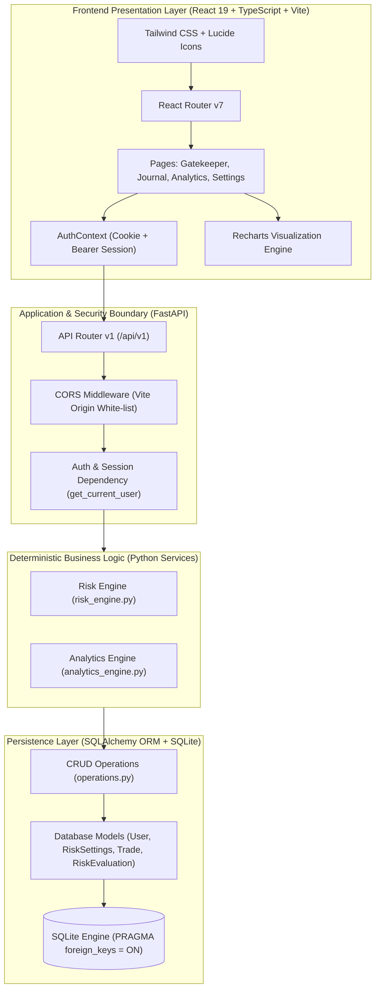

# TradePilot System Architecture

TradePilot is an academic decision-support platform designed to counter behavioral trading biases by embedding deterministic, pre-trade risk controls into a systematic trading workflow.

---

## 1. Architectural Principles

1. **Deterministic Sizing Over Intuition**: Position sizing and clearance are computed via closed-form decimal formulas based on account equity, explicit risk percentages, and structural invalidation points (stop loss).
2. **Authoritative Backend Truth**: Metric calculations (win rate, profit factor, drawdown, cumulative equity) are computed on the backend server over persisted database records. The frontend client is strictly a rendering layer and never invents synthetic metrics.
3. **Strict Zero-Trust User Isolation**: All read and write operations are strictly filtered and scoped to `current_user.id`. Cross-user access returns `HTTP 404 Not Found` rather than leaking record existence.
4. **Decimal Precision**: Financial fields (`entry_price`, `stop_loss`, `realized_pnl`, `quantity`) use `Numeric(precision=18, scale=6)` in SQLAlchemy and Python's `decimal.Decimal` to eliminate binary floating-point roundoff errors.

---

## 2. Component Responsibilities

### 2.1 Frontend (`frontend/`)
- **`src/context/AuthContext.tsx`**: Central authentication provider managing user session lifecycle, login, registration, logout, and token restoration via `GET /api/v1/auth/me`.
- **`src/lib/api.ts`**: Standardized fetch wrapper configured with `credentials: 'include'` for HttpOnly cookies and standardized `ApiException` parsing.
- **`src/pages/RiskGatekeeperPage.tsx`**: Pre-trade order simulation interface. Enforces structural stop placement, calculates exact share/contract sizing, and allows one-click persistence into the trading journal upon clearance.
- **`src/pages/TradingJournalPage.tsx`**: Journal interface supporting filtering (status, side, symbol, date range), pagination, editing, and closing of trades.
- **`src/pages/AnalyticsPage.tsx`**: Performance dashboard displaying equity curves, drawdown series, win/loss breakdown, and Gatekeeper compliance stats.
- **`src/pages/SettingsPage.tsx`**: Configuration center for user-level risk limits (`max_risk_per_trade_pct`, `max_daily_loss_pct`, `enforce_mandatory_stop_loss`).

### 2.2 Backend (`backend/`)
- **`app/main.py`**: ASGI application factory, CORS configuration, exception handling, and database lifespan initialization.
- **`app/core/security.py`**: Cryptographic operations utilizing `bcrypt` for password hashing and `python-jose` for signed HMAC-SHA256 JWT tokens.
- **`app/api/deps.py`**: Dependency injection providing isolated database sessions (`get_db`) and authenticated user resolution (`get_current_user`).
- **`app/services/risk_engine.py`**: Core mathematical risk evaluator enforcing:
  - Account equity and risk percentage bounds.
  - Directional stop loss placement (Long: Stop < Entry; Short: Stop > Entry).
  - Minimum reward-to-risk ratio (R:R).
  - Lot size increment rounding (floor rounding to avoid exceeding risk budget).
  - Daily loss limit breach checks.
  - Hard ceiling checks against user-configured maximum risk per trade.
- **`app/services/analytics_engine.py`**: Deterministic analytics calculator providing:
  - Chronological ordering of realized outcomes.
  - Net and gross profit/loss with consistent transaction fee deduction.
  - Win rate calculation excluding open trades and breakeven trades from denominative bias.
  - High-water mark drawdown tracking.
  - Gatekeeper rule violation percentages.
- **`app/db/session.py`**: SQLite database session setup with explicit `PRAGMA foreign_keys = ON` connection listeners.
